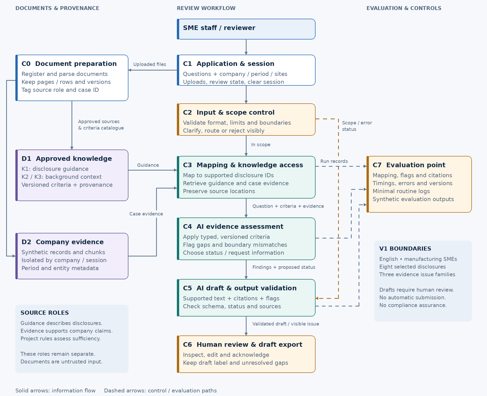

# Topic 2 — V1 Architecture Decisions & Traceability

**Project:** ESGReady — An Evidence-Grounded ESG Questionnaire Assistant for Malaysian SMEs
**Date:** 5 November 2026. **Architecture status:** Conceptual V1; no software implementation is claimed.

## C1 — Start with the simplest architecture

A user submits a question to an application, which invokes a language model and returns a draft. This starting point supports basic drafting but does not by itself establish source provenance, case isolation, evidence sufficiency, human-review enforcement or measurable run records. The components below are introduced to meet those requirements.

## C2 — Architecture needs derived from requirements

| Need | Requirement | Can the simple flow adequately support it? | Necessary addition |
| --- | --- | --- | --- |
| Citable reference and evidence locations | FR-03, FR-04; NFR-03 | No reliable provenance mechanism | Document preparation, source registration and knowledge access. |
| Separate source roles and companies | FR-04; RAI-04, RAI-06 | No | Typed stores and case filters. |
| Evidence sufficiency and explicit gaps | FR-05–FR-07; RAI-01, RAI-02 | Not reliably through draft generation alone | Criteria catalogue, evidence assessment and status gates. |
| Supported inputs and scope | FR-01–FR-03; NFR-05 | No explicit enforcement | Input validation and scope control. |
| Human review | FR-08; RAI-05 | No | Review state and export gate. |
| Reproducible evaluation | O3; NFR-04, NFR-06 | No | Versioned, minimal run records and evaluation point. |

## C3 — V1 conceptual diagram

Editable diagram: [week2_architecture_v1.drawio](week2_architecture_v1.drawio). Open it in Draw.io / diagrams.net. The PNG is supplied for submission. It and the editable XML were generated from the same component/edge specification; no browser-based Draw.io export is claimed. Open the XML in Draw.io and export there if that workflow is required by the lecturer. Components are labelled by function, not a chosen framework, model or database.

| ID | Component / capability | Responsibility |
| --- | --- | --- |
| C0 | Document preparation and source registration | Validate supported files; extract text with page/row locations; tag source role, version and case ID; visibly flag unreadable content. |
| C1 | Application interface and session | Collect questions and reporting boundaries; manage session state, review actions and requested deletion. |
| C2 | Input and scope control | Enforce limits and supported tasks; route ambiguity/out-of-scope cases to a visible status; treat input as data. |
| C3 | Question mapping and knowledge access | Map to the supported catalogue; retrieve appropriate guidance and active-case evidence separately; keep citations. |
| C4 | Evidence assessment and gap analysis | Apply the versioned criteria, check fields/boundaries, identify issues and select a provisional status. |
| C5 | Draft generation and output validation | Generate supported text; validate structure, source locations, status and criterion origin; stop or flag invalid output. |
| C6 | Human review and draft export | Show sources/gaps, accept edits, require acknowledgement and export a draft table without external submission. |
| C7 | Evaluation and minimal run records | Capture synthetic case outputs, timings, errors and version IDs for later metrics; minimise routine logs. |
| D1 | Approved knowledge and criteria catalogue | K1 disclosure source; K2/K3 background context; typed criterion origins and versioned metadata. |
| D2 | Case-scoped company evidence | Synthetic records and derived chunks separated by company/session; wrong-boundary documents are explicitly traceable candidates. |

### Main information flow

1. C0 prepares approved references and evidence, preserving provenance and roles in D1/D2. The user provides company/period/site boundaries and questions in C1.
2. C2 checks inputs and scope. Invalid or out-of-scope items produce a visible structured status through C5/C6; they do not disappear.
3. C3 retrieves the relevant disclosure/context from D1 and candidate evidence from D2 with the active case filter. A document mentioning the wrong entity can be a candidate mismatch but is never accepted as target-company proof.
4. C4 compares the question, source-derived fields, customer conditions and candidate evidence. It records flags, provenance and unresolved information. Pack-level absence requires checking the supplied inventory and readable content; incomplete parsing/retrieval produces an unresolved state, not a confirmed missing-support finding. Evidence text is untrusted throughout.
5. C5 drafts supported portions and validates the response and citations. Unknown source locations, inconsistent statuses or malformed output trigger retry within a bounded limit or an explicit error/manual-review result.
6. C6 displays the result, gaps and citations for review. Edits reset acknowledgement. Export preserves draft labels and flags; the application has no submission action.
7. C7 receives version IDs, outcomes and timings at evaluation points. Full synthetic outputs are saved only in evaluation runs; routine logs avoid full document text. C1 clear-session requests remove application-owned session artefacts including temporary output and derived evidence.

Dashed arrows in the diagram show measurement/control paths. Components are logical responsibilities and can be implemented inside one small application. They do not imply separate servers or agents. C3–C5 may share one language-model service. Specific retrieval methods, providers and UI technologies will be selected after a development pilot.

### Failure and abstention behaviour

Unreadable evidence is reported as a processing problem, not proof that information is absent. Missing boundaries require clarification. Unsupported questions receive a prototype-scope explanation. Evidence gaps prevent ready-draft status; unclear/conflicting evidence is referred for review. A service failure produces an explicit error and preserves the original question. None of these routes silently returns a fabricated answer.

## C4 — Architecture Decision Records

| Decision | Requirement / constraint | Alternatives considered | Selected option | Trade-off accepted |
| --- | --- | --- | --- | --- |
| ADR-01 | FR-03–FR-05; NFR-01, NFR-06 | All ESG frameworks; selected SEDG catalogue | Pin eight IDs and typed criteria; K2/K3 are context only. | Less coverage; simpler source interpretation and reproducible testing. |
| ADR-02 | FR-04; RAI-04, RAI-06 | One untyped document pool; separate roles/case filters | Maintain logical guidance and company-evidence separation with explicit case filtering. | More metadata handling; avoids confusing general guidance with company proof. |
| ADR-03 | FR-05–FR-07; NFR-02; RAI-01 | Draft-only; explicit checks; several specialised models | Begin with one semantic assessment capability plus deterministic metadata/schema gates; no required NLI model. | Semantic checks can still err; explicit gates and benchmarks expose limits without adding multiple models prematurely. |
| ADR-04 | RAI-01, RAI-02; FR-06 | Always answer; model-reported confidence threshold; evidence gates | Use evidence/metadata sufficiency and explicit status rules; clarify/abstain when unresolved. | May produce more information requests; evaluate coverage and false alarms. No uncalibrated probability label. |
| ADR-05 | FR-08; RAI-05 | Automatic submission; optional review; required acknowledgement | Human review gate and draft export only. | Extra user step; avoids hidden finalisation and retains unresolved issues. |
| ADR-06 | FR-02; NFR-04, NFR-05 | OCR/all formats; text PDFs/CSV and short batches | Support bounded, machine-readable input; defer OCR and large queues. | Reduced input coverage; lower parsing complexity and more predictable tests. |
| ADR-07 | NFR-06; RAI-04; O3 | Log everything; no logs; purpose-limited records | Keep versioned synthetic evaluation records; routine logs omit full evidence text; local session cleanup supported. | Less production debugging detail; course reproducibility without unnecessary data exposure. |
| ADR-08 | O2; limited course time | Full emissions tools; no calculations in V1 | Use reported figures as evidence; do not calculate emissions or invent missing totals. | Fewer features; concentrates effort on the evaluated evidence-review task. |

## Initial requirements traceability matrix

All evidence listed below is **planned for later implementation/evaluation**. No entry denotes a completed test. O3 also governs collection and analysis of all evaluation records.

| Objective | Requirement | Evaluation criterion | Architecture element | Later evidence |
| --- | --- | --- | --- | --- |
| O1 | FR-01 | EC-05 | C1, C2 | Boundary-missing scenario outcomes |
| O1, O2 | FR-02 | EC-10 | C0, C1, C2 | Input-limit/parser error scenario records |
| O1, O2 | FR-03 | EC-01, EC-05 | C2, C3, D1 | Gold/predicted disclosure ID sets |
| O1, O2 | FR-04 | EC-02, EC-03, EC-07, EC-11 | C0, C3, D1, D2 | Retrieved locations, source lineage and case-filter logs |
| O2 | FR-05 | EC-02, EC-04, EC-11, EC-12 | C4, D1, D2 | Criterion findings, confusion counts and actionability ratings |
| O2 | FR-06 | EC-04, EC-08, EC-10, EC-12 | C5, C6 | Schema/status records and user-task outcomes |
| O2 | FR-07 | EC-03, EC-04, EC-06 | C4, C5 | Claim support audits and malicious-input outcomes |
| O1, O2 | FR-08 | EC-08, EC-12 | C1, C6 | Review/edit/export scenario results |
| O1, O2 | FR-09 | EC-05 | C2, C3, C5, D1 | Ten background-answer citation/authority audits |
| O2 | FR-10 | EC-07 | C0, C1, D2, C7 | Ten deletion scenarios and residual-file inspection |
| O1, O3 | NFR-01 | EC-01 | C3, C7 | Exact-set mapping accuracy |
| O2, O3 | NFR-02 | EC-02 | C3, C4, C7 | Per-family precision/recall and clean false alarms |
| O2, O3 | NFR-03 | EC-03 | C3, C5, C7 | Claim–citation audit table |
| O2, O3 | NFR-04 | EC-09 | C1–C5, C7 | Timing/usage records with environment manifest |
| O2, O3 | NFR-05 | EC-10 | C0, C2, C5, C7 | Fifty workflow-scenario outcomes |
| O1, O3 | NFR-06 | EC-11 | C0, D1, C7 | Version manifests and catalogue update/rollback result |
| O2, O3 | RAI-01 | EC-04, EC-05 | C4, C5, C6, C7 | False-ready count and assurance-prompt audit |
| O2, O3 | RAI-02 | EC-04, EC-05 | C2, C4, C5, C7 | Safe handling, clean coverage and scope accuracy |
| O2, O3 | RAI-03 | EC-06 | C2, C3, C4, C5 | Twenty adversarial-case outcomes |
| O1, O2, O3 | RAI-04 | EC-07 | C0, C1, C3, D2, C7 | Isolation/deletion tests and repository/log review |
| O1, O2, O3 | RAI-05 | EC-08 | C1, C5, C6 | Ten warning and review-gate checks |
| O1, O2, O3 | RAI-06 | EC-05, EC-11 | D1, C4, C5, C7 | Criterion-origin and authority audit |

## Final V1 design review

- [x] Each major component has a requirement or evaluation purpose.
- [x] Guidance, contextual sources and company evidence have distinct roles.
- [x] Input scope, case isolation, human review and abstention are represented.
- [x] Source versions, page/row references and criterion provenance are preserved.
- [x] Every FR, NFR and RAI requirement has a traceability row.
- [x] The architecture uses functional labels and avoids premature technology choices.
- [x] Emissions tooling, OCR and multi-model ensembles are deferred.
- [x] The design can be implemented as one application with logical modules.

These checks confirm specification consistency, not operational correctness. Implementation still requires the tests in the evaluation plan.

### Part C reflection

ADR-03 has the most important trade-off. FR-05 and RAI-01 require identifying evidence defects before drafting, so the design adds an explicit assessment step. This improves inspectability but adds latency and may incorrectly flag valid evidence. A single semantic capability with deterministic metadata gates is the initial compromise. The baseline comparison, per-family error analysis and clean-case drafting coverage will show whether the extra step earns its cost.
