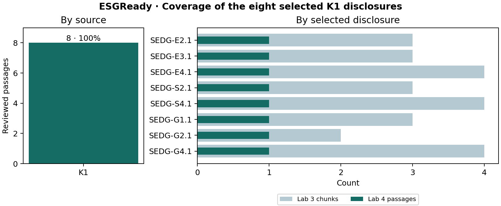

# ESGReady | Data Quality, Bias, and Responsible Data Report

**Topic 4 · SAIA 3113 AI Engineering · 25 November 2026**

**Decision — GO WITH CONDITIONS.** Eight source-checked guidance passages are ready for private review of the pinned K1 catalogue. Each retains its original source, physical page and exact parent text locations. Public redistribution, company-evidence assessment and claims about assistant performance require separate evidence.

## 1. Data Quality Scorecard

The unit of assessment changes from 26 input chunks to eight reviewed passages. The scores below concern the defined eight-ID guidance task. A 5 means every item passed the stated test on this snapshot. N.V. means the evidence cannot establish the property.

| Dimension | Rating | Measured evidence | Scope or action |
|---|---:|---|---|
| Completeness | 5/5 | All eight required Basic entries appear in full in the reviewed set. Independent PDF-column comparison passed for 8/8. | Limited to Lab 2’s selected guidance. K2, K3 and synthetic company packs remain separate. |
| Consistency | 5/5 | 26/26 input role, page-map and source-snapshot checks passed. Both final formats agree on all eight IDs, texts and metadata records. | The eight input chunks containing several printed IDs needed boundary review. |
| Accuracy | 5/5 for transcription of the selected passages | All eight final passages match the selected column in the hash-matched PDF when whitespace is ignored. Original case, punctuation and wording were retained. | This evaluates extraction. Question mapping, interpretation and citation support in generated answers remain untested. |
| Timeliness | N.V. | July 2025 edition confirmed from the publication notice. The publisher URL returned the same bytes as the November 2026 Lab 3 manifest. | A stable download cannot establish that there is no newer edition. Check publisher releases before indexing or updating. |
| Uniqueness | 5/5 for exact-normalised text | 26 distinct normalised input hashes from 26 chunks. Final set has eight distinct criterion IDs and one passage per ID. | Similar meaning, repeated reference phrases and conflicts across versions require different tests. |

## 2. Validation and Data-Defect Findings

Two Lab 2 requirements guided the review. **FR-03** needs a complete, correctly bounded criterion at each cited page. Missing or mixed criteria could misroute a question. **FR-04** needs a traceable version, locator and source role so company facts cannot be inferred from general guidance. A role or provenance mismatch blocks release.

All ten rules ran with Pandera on the same **26 original chunks**. Percentages below use 26 as denominator. The notebook computes properties on the original text before any filtering. The failure CSV records the affected ID, page, observed length, printed-ID count and disposition.

| Observable condition | Failure detected | Failures | Decision |
|---|---|---:|---|
| Stripped text has at least one character | Empty evidence slot | 0 (0%) | Hard fail |
| Source filename present after stripping | Untraceable source | 0 (0%) | Hard fail |
| Filename, K1 ID, URL, version and SHA-256 agree with the manifest | Mismatched snapshot | 0 (0%) | Hard fail |
| Role equals disclosure_guidance | Wrong authority or evidence collection | 0 (0%) | Hard fail |
| Physical page maps to the expected candidate ID | Wrong catalogue location | 0 (0%) | Hard fail |
| Original record ID occurs once | Ambiguous lineage | 0 (0%) | Hard fail |
| No null byte or Unicode replacement character | Detectable decoding damage | 0 (0%) | Hard fail |
| No run of four spaces or four newlines | Possible whitespace noise | 0 (0%) | Inspect layout before editing |
| Stripped length at least 100 characters | Possible tail left by a 500-character split | 5 (19.2%) | Inspect each short input beside its predecessor |
| At most one distinct printed SEDG ID | Possible mixing of criteria in one chunk | 8 (30.8%) | Locate the selected entry on the source page |

**13 distinct inputs were flagged (50.0%).** There were zero hard failures. Length ranged from 3 to 500 characters, with median 499 and mean 375.35. The 100-character cutoff is a review heuristic for this input pipeline. A short statement can express a complete criterion. The test does not apply as a cutoff to the cleaned entries.

**Interpretation.** Missing text, missing filename, specified corruption markers and the specified whitespace pattern each occurred zero times. Visual inspection still found merged column headings, words broken across boundaries, reference lists and neighbouring criteria. These are extraction or interpretation problems. No stale record was established. Currency beyond the pinned edition remains N.V.

## 3. Duplicate and Anomaly Findings

Whitespace was collapsed and each input text was SHA-256 hashed with case and punctuation preserved. **26 before exact deduplication, 26 after, zero duplicates.** The duplicate CSV therefore contains its header and zero data rows. The drop from 26 inputs to eight outputs comes from selecting the eight in-scope criteria. Ten parent chunks contributed exact spans, and 16 contributed no in-scope text. All 26 originals remain available for audit. The source-disposition ledger accounts for every original ID.

| Original record(s) | Evidence and classification | Decision taken |
|---|---|---|
| K1-p0026-c001 and c002 | The first chunk includes consumption and reduction, then splits a fuel category mid-word. The second has no printed ID but starts with the continuation. | Combined the exact E2.1 slices before normalising whitespace. Preserved applicable categories and units. |
| K1-p0030-c001 and c002 | The water criterion introduces a breakdown at the end of c001. Its categories continue in c002. | Included both spans up to the reference section. |
| K1-p0034-c001, c002 and c004 | c001 contains two advanced IDs despite its E4.1 page hint. E4.1 starts in c002. The three-character c004 is the end of a reference-table label. | Kept the Basic span in c002. Advanced entries and the reference tail remain in the source export. |
| K1-p0046-c001 | S2.1 and S2.3 are both Basic entries. The inspected page shows average training hours and a separate minimum-wage entry. | Stopped the training passage at S2.3. Selecting the entire Basic column would include an unrelated criterion. |
| K1-p0053-c004 | A valid list of reference frameworks has the safety page’s candidate ID. It supplies no company injury count. | Retained it in the original only. |
| K1-p0075-c004 | A 13-character tail finishes a reference label on the anti-corruption page. | Excluded the tail. The reviewed criterion keeps the incident-count and descriptive elements. |

**Why manual inspection mattered.** A correct ID and page allow a reader to find the source, yet they cannot establish which column or list a sentence belongs to. A reference to injuries can also be authentic while giving no information about a particular company. Contradictions between versions or company records remain N.V. because this run contains neither comparison set.

The visual review covered physical PDF pages 26, 30, 34, 46, 53, 62, 65 and 75. The notebook independently compared the reviewed passages with text inside the selected PDF column and reconstructed them from the Lab 3 parent offsets. Both checks passed 8/8. Source digest: `c7699997922c6735ceb1ae494eb2511841c66bd03a228807ae15eba3730ace19`. [Capital Markets Malaysia, SEDG Version 2, July 2025](https://sedg.capitalmarketsmalaysia.com/wp-content/uploads/2025/07/SEDG-v2.pdf)

## 4. Representation, Coverage, and Bias Assessment

Adequacy for D1 means that each of the eight selected IDs has its complete authoritative passage and a resolvable physical page. Before cleaning, the candidate ID was a page-level proxy. After review, the verified ID identifies the selected passage. The E/S/G group is derived from the ID prefix. All 26 inputs and all eight reviewed passages come from K1 (100%). The allocation reflects the agreed scope for Malaysian manufacturing-SME examples in English.

| K1 disclosure | Subject | Physical PDF page | Input chunks tagged by page | Reviewed / expected |
|---|---|---:|---:|---:|
| SEDG-E2.1 | Energy consumption | 26 | 3 | 1/1 |
| SEDG-E3.1 | Water withdrawal | 30 | 3 | 1/1 |
| SEDG-E4.1 | Waste totals | 34 | 4 | 1/1 |
| SEDG-S2.1 | Average employee training hours | 46 | 3 | 1/1 |
| SEDG-S4.1 | Fatalities and injuries | 53 | 4 | 1/1 |
| SEDG-G1.1 | Director count | 62 | 3 | 1/1 |
| SEDG-G2.1 | Company policies | 65 | 2 | 1/1 |
| SEDG-G4.1 | Confirmed corruption incidents | 75 | 4 | 1/1 |

| Potential bias and origin | Who or what could be affected, and how | Intervention and Topic 8 test |
|---|---|---|
| Representation. Engineering selection gives eight English K1 criteria and zero K2/K3 or company records. | For an unsupported question, retrieval limited to D1 could return the nearest familiar topic. Generation might draft a company claim from guidance. | Separate source roles, require D2 evidence for company claims and route unsupported questions to review. Test the 20 scope/ambiguity items, audit citations by role, and inspect false-ready cases. |
| Measurement. The extraction pipeline assigns the same candidate label to every chunk on a page. Eight inputs contain multiple IDs. | An energy or training question could retrieve a neighbouring criterion. A generator could ask for reductions or wages when the question asks about consumption or training. Treating page labels as gold could hide the error. | Use the reviewed spans. Compare predicted ID sets with independent gold labels by disclosure. Audit claim–citation support and examine wrong-field errors on multi-criterion pages. |
| Historical coverage. The source represents the July 2025 guidance and this corpus captures one edition. | Users asking about current guidance could receive an older criterion if the publisher has revised it. | Check revision history, version each corpus and test update/rollback and stale-source handling. Supersession and its effect have yet to be established. |

The input counts measure how the chunker split the PDF. They provide no measure of user-group fairness, real SME representation or downstream error rates.

## 5. Privacy, Consent, Rights/Access, and Data Governance

| Governance question | Evidence and status | Owner and action |
|---|---|---|
| Owner, version and provenance | **Traceable.** K1’s publisher, July 2025 edition, URL, SHA-256 and page map agree with the inventory and checked PDF. Original JSONL hash matches the Week 3 manifest. | Project owner retains hashes, original records and parent offsets for each version. |
| Access and sharing | **Redistribution to verify.** The publication notice on physical page 3 reserves rights. The earlier source register documents public reference access. No permission for republishing extracted text is evidenced here. | Project owner keeps the full handoff and text-bearing notebook outputs private. Before sharing extracts, confirm the applicable course delivery route and permission. Share the report, metadata and reproducible procedure where appropriate. |
| Personal or sensitive data | **No personal records observed in scope.** Eight published criteria concern reporting categories. There are no company files, employees’ details or student participant datasets in the reviewed corpus. | Keep future D2 synthetic records separate and case-scoped. Check future uploads independently. |
| Consent or collection basis | **N/A for this corpus.** There are no participants or collected individual records. | For planned peer usability work, apply the voluntary process in Lab 2 when recruiting. |
| Updates, retention and removal | **Procedure defined here.** A current-edition check and an operational rollback exercise remain open. | Before Topic 7 indexing, project owner checks the publisher and records edition/date/hash. On change, rerun visual review and archive the previous manifest under its version. Remove superseded entries from the active index; retain only authorised local inputs for the course review period, then remove temporary copies. |

## 6. Mitigation Plan and Residual Risk

| Issue | Evidence | Action | Owner / timing | Residual risk |
|---|---|---|---|---|
| Column and word splits | Eight multi-ID flags and joined words on p26 | Completed eight manual boundary decisions, independent column comparisons and parent-span checks. Repeat on every changed hash. | Project owner, this run and each source revision | Coordinates are specific to this PDF layout. |
| Inappropriate source reuse | K1 only in D1, zero D2 records | Enforce source-role filtering and active-case evidence requirements before enabling company drafts. | Developer, Topic 7; evaluate in Topic 8 | A model may still use a correctly retrieved source incorrectly. |
| Supersession and sharing | Single dated version; publication notice and unverified sharing permission | Record current-edition check and permission or approved restricted delivery before the relevant use. | Project owner, before indexing or distribution | A publisher may later revise the guide or its terms. |
| Narrow evidence for evaluation | Eight selected topics; no held-out predictions | Construct separate synthetic company packs and compare the Lab 2 baseline and checker on fixed cases. | Project owner and planned reviewer, Topic 8 | Synthetic results may not generalise to real SMEs. |

## 7. Impact on Topic 2 Requirements / Evaluation Criteria

| Requirement and later target | How a data issue could cause failure | Evidence available now |
|---|---|---|
| FR-03 / NFR-01 / EC-01. Exact-set mapping ≥136/160. | Mixed energy or training criteria could produce extra IDs. | Eight known target passages. Mapping accuracy is unmeasured. |
| FR-04 / FR-07 / NFR-03 / EC-03. Citation support precision and claim citation completeness both ≥0.95. | A technically valid K1 link could be used as proof of a company fact. | K1 role and physical pages verified. Claim-level grounding needs model outputs and case evidence. |
| FR-05 / RAI-01 / RAI-02 / EC-04. False-ready ≤6/120, safe handling ≥114/120, clean drafting ≥32/40. | General guidance gives no basis for a nil incident claim. Retrieval failure could be mistaken for missing support. | No synthetic company packs were evaluated. All three targets remain future tests. |
| NFR-06 / RAI-06 / EC-11. Complete lineage for 160/160 results, correct criterion origin and successful update/rollback. | A page hint promoted to an official rule could misstate authority even with a genuine source link. | Guidance origin and parent spans are recorded on 8/8. Full result lineage and operational rollback remain untested. |

## 8. Topic 4 Quality Gate Decision

**GO WITH CONDITIONS** for the eight-entry private, pinned K1 guidance collection. The input hand-off and final format pair agree. All eight passages match the intended Basic entries. Every excluded input remains traceable. The collection can support private course review and Topic 5 design discussion.

1. **Before Topic 7 indexing**, the project owner records a publisher edition check. A changed PDF or prepared-input hash requires renewed boundary review. Load the reviewed JSONL or its matching PKL.
2. **Before distributing K1 text**, the project owner verifies the permitted audience and sharing route. Pending confirmation, retain text-bearing artefacts privately and provide an authorised regeneration route.
3. **Before assessing company evidence**, the developer prepares and verifies separate synthetic D2 packs and tests role/case separation. Until then, D1 can supply guidance only.
4. **Before claiming system performance or fairness**, complete the relevant Topic 8 held-out tests. Carry open findings into the Week 7 proposal and Week 14 Responsible AI review.
